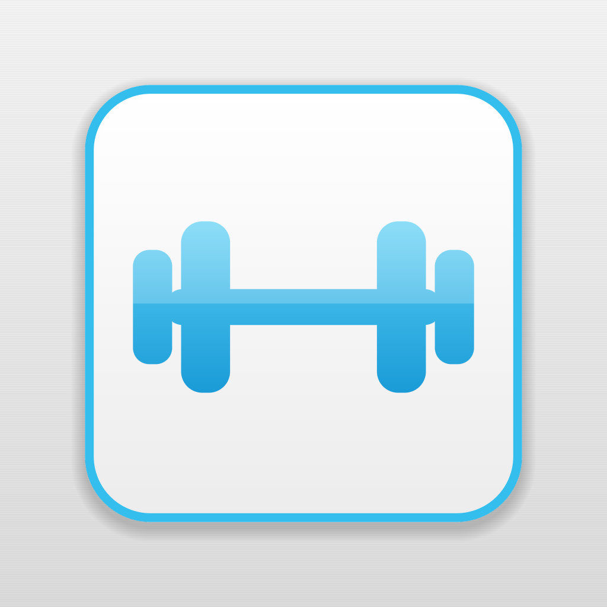
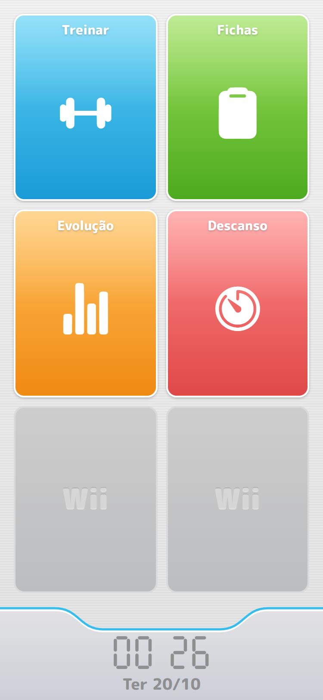

<p align="center">
  
</p>

<h1 align="center">My Gym</h1>

<p align="center">
  A workout tracker for Android with a look inspired by the Nintendo Wii Menu.<br />
  Built with React Native and Expo. Works fully offline.
</p>

<p align="center">
  
</p>


## Features

### Treinar — log a workout
- Pick today's routine and start; every set comes pre-filled with the routine's weight and reps.
- Edit weight (kg) and reps per set, tap ✓ to mark it done, add or remove sets on the fly.
- A rest timer pops up automatically after each set (90 s by default, ±15 s), vibrating when it ends.
- Elapsed time and a progress bar for the session.
- The workout in progress is saved, so closing the app doesn't lose it.
- A Wii Sports–style **results screen**: duration, sets, reps, total volume and **new personal records**.

### Fichas — routines
- Routines such as *Treino A, B, C*, each with a letter, a name and a color.
- Exercises with sets, reps (e.g. `10` or `8-10`), suggested weight and notes.
- Reorder exercises with up/down arrows; deleting asks for confirmation.

### Evolução — progress
- Workouts this week and this month.
- 12-week frequency calendar.
- Personal records (heaviest weight per exercise).
- Per-exercise line chart for **max weight**, **volume** or **estimated 1RM** (Epley), with
  *1 month / 3 months / all* filters, tap-to-read values and a table view.
- Workout history for the period; long-press a workout to delete it.

### Descanso — rest timer
- Type minutes and seconds; a large ring counts down smoothly.
- Pause, resume and restart; vibrates and plays a chime at the end.
- Keeps the screen awake while running and remembers the last duration.

### The Wii look
- Neutral grey background with fine stripes, like the Wii Menu.
- Home screen as a channel grid, with empty slots showing an embossed "Wii".
- Bottom bar with the curved cyan line and a seven-segment clock.
- White buttons with cyan outlines, glossy color bubbles and bouncy press animations.

## Tech stack

| | |
|---|---|
| Framework | [Expo](https://expo.dev) SDK 57 · React Native 0.86 · React 19 |
| Language | TypeScript |
| Navigation | Expo Router (file-based routes in `src/app`) |
| Animation | React Native Reanimated |
| Charts & drawings | react-native-svg (hand-rolled charts, clock digits and timer ring) |
| Storage | AsyncStorage (all data stays on the device) |
| Audio / screen | expo-audio, expo-keep-awake |
| Font | M PLUS Rounded 1c |

## Getting started

Requirements: [Node.js](https://nodejs.org) (LTS) and the [Expo Go](https://expo.dev/go) app on your
phone, in a version that supports **SDK 57**.

```bash
npm install
npx expo start
```

Scan the QR code with Expo Go (phone and computer on the same Wi-Fi). To preview in the browser:

```bash
npx expo start --web
```

Checks used during development:

```bash
npx expo lint
npx tsc --noEmit
npx expo-doctor
```

> If `npm`/`npx` fails with `UNABLE_TO_VERIFY_LEAF_SIGNATURE` (common when an antivirus inspects
> HTTPS traffic), run it with `NODE_OPTIONS=--use-system-ca` so Node trusts the Windows certificate store.

## Building the Android APK

APKs are built in the cloud with [EAS Build](https://docs.expo.dev/build/introduction/) (free Expo account needed):

```bash
npx eas-cli@latest login
npx eas-cli@latest build -p android --profile preview
```

When the build finishes, EAS prints a link to download the `.apk`. Install it on the phone and allow
installing from that source when Android asks. Build profiles live in [`eas.json`](eas.json):
`preview` produces an installable APK, `production` an app bundle for the Play Store.

The Android package is `com.myacademy.app`. Keep it unchanged so new APKs install over the old one
without losing data.

## Project structure

```
src/
  app/            Screens (Expo Router)
    index.tsx       Home: channel grid + clock bar
    treinar/        Pick routine, workout session, results
    fichas/         Routine list, routine detail, routine and exercise forms
    evolucao.tsx    Progress: summary, calendar, records, charts, history
    timer.tsx       Rest timer
  components/     Reusable UI (Wii buttons, channel tiles, charts, timers…)
  config/         Easy-to-edit settings (menu channels, rest timer defaults)
  data/           Persistent stores and stats (routines, workouts, records)
  hooks/          useNow, useCountdownProgress
  theme/          Colors, fonts, spacing and shadows
  utils/          Formatting, dates, ids, confirmations
scripts/
  generate-icons.js   Draws the app icon and splash image in code
  generate-plim.js    Synthesizes the rest-timer chime
```

## Customizing

| What | Where |
|---|---|
| Colors, fonts, corner radius, shadows | [`src/theme/index.ts`](src/theme/index.ts) |
| Home channels, number of grid slots, empty-slot label | [`src/config/channels.ts`](src/config/channels.ts) |
| Rest time after a set and the ±step | [`src/config/workout.ts`](src/config/workout.ts) |
| App icon and splash image | [`scripts/generate-icons.js`](scripts/generate-icons.js), then `node scripts/generate-icons.js` |
| Timer chime | [`scripts/generate-plim.js`](scripts/generate-plim.js), then `node scripts/generate-plim.js` |
| App name | `expo.name` in [`app.json`](app.json) |

## Data

Everything is stored locally with AsyncStorage. There is no account, server or sync.
Uninstalling the app deletes its data. Exercises are matched by **name** (case-insensitive) for
charts and records, so the same exercise in different routines counts as one.

## Credits

- Fan-made project inspired by the Nintendo Wii Menu and Wii Sports. Not affiliated with or endorsed
  by Nintendo. "Wii" is a trademark of Nintendo.
- [M PLUS Rounded 1c](https://fonts.google.com/specimen/M+PLUS+Rounded+1c) font (SIL Open Font License).
- [Ionicons](https://ionic.io/ionicons) icons (MIT).
- App icon and timer chime are generated in code by the scripts in [`scripts/`](scripts).
